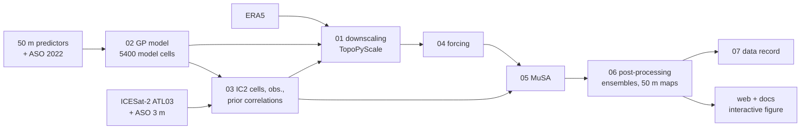

# East River snow-depth assimilation with ICESat-2 (MuSA)

Code of the paper *Leveraging probabilistic machine learning to enable large scale assimilation of ICESat-2
snow depth observations* by Mazzolini, Aalstad, Cowherd, Alonso-González, Girotto and Treichler (manuscript
for Geoscientific Model Development).

ICESat-2 (IC2) snow depth at 400 cells per water year is assimilated with MuSA (FSM2 snow model, 100
members, iterative ensemble smoother) and spread to 5400 model cells of the East River basin, Colorado,
with a Gaussian-process (GPE) or Gaspari–Cohn (GCE) prior correlation. The ensembles are mapped to a 50 m
grid and compared with Airborne Snow Observatory (ASO) lidar on 1 April 2023 and 3 April 2024.

- **Code archive** (this repository, release v1.0): https://doi.org/10.5281/zenodo.23914632
- **Data record** (input data, outputs of the four experiments, website data): https://doi.org/10.5281/zenodo.23894419
- **Interactive figure**: https://mmazzolini.github.io/eastriver-snow-viewer/ (source in [`docs/`](docs/))

## Processing chain

| Folder | Step | Main environment |
|---|---|---|
| [`01_era5_downscaling/`](01_era5_downscaling/) | ERA5 download in one step; TopoPyScale downscaling of the model cells and the IC2 cells | `downscaling` |
| [`02_gp_model_points/`](02_gp_model_points/) | scaler, sparse GP of snow depth on the predictors, selection of the 5400 model cells | Python 3.11 + GPy 1.13.2 |
| [`03_ic2_cells_obs_corr/`](03_ic2_cells_obs_corr/) | ATL03 photons, synthetic IC2 snow depth, the 400 IC2 cells per year, observation files and error variances, GP and Gaspari–Cohn correlation matrices | `gpy-env`, `MuSAenv`, SlideRule |
| [`04_forcing/`](04_forcing/) | daily MuSA forcing files of the model cells and the IC2 cells | `downscaling` |
| [`05_musa/`](05_musa/) | pointer to MuSA `eastriver-paper` ([fork](https://github.com/mmazzolini/MuSA/tree/eastriver-paper), tag `eastriver-paper-v1`; archived at https://doi.org/10.5281/zenodo.23893780): MuSA with minimal changes (upstream code between v2.2 and v2.3) and the four experiment configurations | `MuSAenv` |
| [`06_postprocessing/`](06_postprocessing/) | ensembles to netCDF; mapping of the ensembles to the 50 m grid | `MuSAenv`, `gpy-env` |
| [`07_data_record/`](07_data_record/) | staging and upload of the Zenodo data record | `gpy-env` |
| [`web/`](web/), [`docs/`](docs/) | data files and page of the interactive figure | `gpy-env`, Node.js |
| [`environments/`](environments/) | conda environments exported from the cluster | |

Each folder has a README with the run order, inputs and outputs, the original file each script comes
from, and the checks that compare the scripts' outputs with the files used in the paper.

## Reproducing

The scripts ran on the Savio cluster (UC Berkeley) with Slurm; the `sbatch_*.sh` wrappers carry its
account, partitions and module names, and the paths block at the top of each script points to the data
folders used there. Adapt both to your system.

- The data record holds the inputs that no script here downloads (`input_data/`): the 7 predictors of
  the GP on the 50 m grid (`GP_predictors/predictors_50m.nc`), the DEM and the point files of the
  downscaling (`DEM/srtm_eastriver_clipped.tif`, `points/GP_points.csv`, `IC2NP_23.csv`,
  `IC2NP_24.csv`). See the table below for where each folder of the record comes from.
- ERA5 needs a Copernicus Climate Data Store account (`~/.cdsapirc`); ATL03 is read through SlideRule.
- ASO snow depth (used to train the GP and to evaluate the results) comes from the Airborne Snow
  Observatories.
- TopoPyScale 0.2.2 with the two changes used here: `01_era5_downscaling/topopyscale_v0.2.2_eastriver.patch`
  (or `pip install git+https://github.com/mmazzolini/TopoPyScale@v0.2.2-eastriver`, the same code).
- The prior maps of MuSA are random draws (`seed = None`), so a rerun gives a statistically equivalent
  prior, not the same one; the ensembles of the paper are in the data record (`DA_experiments/`).

## Data record

| Folder of the record | Content | Written by | Read by |
|---|---|---|---|
| `input_data/DEM/` | `srtm_eastriver_clipped.tif` | (SRTM, clipped) | `01` |
| `input_data/points/` | `GP_points.csv` (5400 model cells), `IC2NP_23.csv`, `IC2NP_24.csv` (400 IC2 cells per year) | `02` s5, `03` s5 | `01`, `03`, `04`, `web` |
| `input_data/GP_predictors/` | `predictors_50m.nc`: the 7 GP predictors of the 50 m stack `all_data50from3_1702.nc` that `02`, `03` (s3), `06` and `web` read; the stack also holds ASO snow depth, which is not in the record (see `02_gp_model_points/README.md`) | `07` | |
| `DA_experiments/<yy>_<GPE\|GCE>/prior/` | `En_snd<yy>_Pr.nc`, `Prior<yy>_mapped<date>[_ens].nc` | `06` | `web` |
| `DA_experiments/<yy>_<GPE\|GCE>/posterior/` | `En_snd<yy>.nc`, `Post<yy>_mapped<date>[_ens].nc` | `06` | `web` |
| `website_data/` | data files of the page in `docs/` (no ASO) | `web` | `docs` |
| `documentation/` | `README.md` (= `07_data_record/RECORD_README.md`), `md5sums.txt` | `07` | |

The experiment folders map to the MuSA runs (configs in `eastriver/` of MuSA `eastriver-paper`) as 23_GPE = `23GPpow2NPnbm_var`,
23_GCE = `23GCpow2NP_var`, 24_GPE = `24GPpow2NPnb_var`, 24_GCE = `24GCpow2NP_var`. On Zenodo each folder
is one zip file that keeps these paths (see [`07_data_record/`](07_data_record/)).

## Licence

GPL-3.0 (see `LICENSE`), as MuSA. The TopoPyScale patch in `01_era5_downscaling` keeps TopoPyScale's MIT
licence (notice in the patch).
